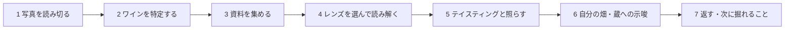

# ワインの深掘り（生産者の目で）

飲み手向けの解説ではない。生産者が「このワインはどこで、どんな年に、どう造られたのか」「なぜこの味なのか」「自分の畑や蔵で何に使えるか」を理解するための深掘り。写真は手がかりにすぎない。答えは調べて確かめる。

## 0. 設定を読む

🧭 AI設定ページから読む。設定が無いときは、会話やメモリで分かっていること（自分の地域など）を使う。それも無ければ聞かずに初期値で進める。何を使ったかを結果に1行書く。

| 設定 | 使いみち | 無いときの初期値 |
| --- | --- | --- |
| 自分の地域と、比べる気象観測点 | 年の天候のレンズで並べて比べる | 比較を省き、「設定すれば比べられる」と1行添える |
| 自分の圃場・品種・醸造の概要 | 自分の畑・蔵への示唆 | 一般的な冷涼地の生産者として書く |
| 保存先 `wine_dossiers` | 深掘りの記録を残す | 保存しない（チャットで返すだけ） |
| 深さの既定 | 初回にどこまで掘るか | 要点と、選んだレンズ2〜4つ |

## 1. 写真を読み切る

- **文字はすべて書き起こす。** 表ラベル、裏ラベル、輸入者のシール（品目、原産国、輸入者、酸化防止剤、内容量）、キャップシール、ロット番号、認証マーク、瓶詰め者の表示、法定の用語。小さな文字や斜めの文字ほど、特定と読み解きの手がかりになる
- 読めない箇所は「読めない」と書く。推測で補ったときは、推測だと書く
- 文字以外も見る。瓶の形と色、栓の種類、液の色、澱の有無（写っていれば）
- ワインを特定できないときだけ、足りない写真（表ラベル、キャップなど）を1行で頼む。特定できるなら頼まずに進める

## 2. ワインを特定する

- 生産者、キュヴェ名、ヴィンテージ、呼称（産地・等級）を確定する
- **名前の揺れを全部拾って検索語にする。** 旧醸造所名と改名後の名前、ブランド名と法人名、輸入元のカタカナ表記、現地語と英語
- **年を取り違えない。** 同じキュヴェでも年ごとに品種比率や造りが変わる。見つけた資料がどの年のものかを必ず確かめ、別の年の情報を使うときは「〇年の情報」と書く

## 3. 資料を集める

上の行ほど、その値の根拠として強い。

| 資料 | 分かること | 扱い方 |
| --- | --- | --- |
| ボトルそのもの | その1本の事実（度数、等級、瓶詰め者、ロット） | その1本については最優先 |
| 造り手の公式（サイト、技術資料） | 畑、造り、考え方 | 造りの事実の第一の根拠 |
| 輸入元の資料 | 品種比率、収量、亜硫酸の値、瓶詰め日、味わい | 日本の輸入元は技術資料が詳しいことが多い。必ず探す |
| 法令・公的機関 | 等級・呼称の規則、産地の公的なヴィンテージ報告 | 制度の説明はここで確かめる |
| 気象データ | その年の気温・雨 | 現地の気象機関の観測所が第一。無ければ再解析データ（格子なので、雨や雪は少なめに出やすい） |
| 国営の酒販店（ノルウェー、スウェーデン、フィンランドなど） | 酸・残糖などの分析値、栓、価格 | 公的に近い補助。ページの年が写真の年と同じか確かめる |
| 販売店・評論・記事 | 評判、価格、他の年の味わい | 補助として使う。数値は上の資料で裏を取る |

- **資料の版が複数あるときは、新しい版を基準に、古い版との違いも見る。** 同じ輸入元の資料が年ごとに出ていることがある
- **表の形の資料（技術資料のPDFなど）は、検索結果の断片の数値をそのまま使わない。** 断片では隣の欄の数値が混ざる。資料を開いて、どの欄の値かを確かめてから使う
- 資料どうしが食い違ったら並べて書き、どれを採るかを理由つきで書く（例：度数はラベルの値を採る）
- 調べるときは、各自の自分ルールにあるブラウザやダウンロードの使い方に従う
- 「科学調査」の合言葉があるとき、または科学的な因果を断定して書きたいときは、research の science-research の基準で一次資料に当たる。それ以外は「一般的な整理」と明記して書く
- 資料の文章は長く写さない。要約して、出典を付ける

## 4. レンズを選んで読み解く

毎回すべてのレンズをやらない。写真と資料を見て、**このワインでいちばん面白いところを2〜4つ選んで深く掘る**。残りは7の「次に掘れること」に回す。各レンズで見ることと、生産者として立てる問いは [references/lenses.md](references/lenses.md) にある。

| レンズ | ひとことで |
| --- | --- |
| 表示と等級 | ラベルの言葉の意味と、なぜその等級を選んだか |
| 畑 | 品種、土壌、標高・向き、樹齢、収量、農法 |
| 年の天候 | その年の気温と雨。自分の地域と並べて比べる |
| 醸造 | 工程を時系列に並べ、各工程が何を変えるかと、そのねらい |
| 造り手と系譜 | 修行先、仲間、改名や独立、地域の流れ |
| 量と値段 | 面積、本数、現地と日本の価格 |
| 瓶・栓・流通 | 栓の種類、輸送と保管、亜硫酸が少ないときの注意 |
| 熟成と飲み頃 | 構造と造り手の見立てから |

どのレンズでも、次の4つを守る。

- **事実と考察を分ける。** 事実には出典を付ける。考察には「推測」と書き、何を根拠にした推測かを書く
- **換算は前提を書く。** 単位をそろえ、換算した値には前提と幅を付ける（例：hl/ha から t/ha へは、搾汁率の幅で出す）
- **「毎年か、この年だけか」を確かめる。** まず同じキュヴェの他の年を当たる。見つからなければ、同じ蔵の他のキュヴェ（同じ年・前後の年）の造りと並べ、蔵としての使い分けを読む。どちらも見つからなければ「確かめられなかった」と書く
- **似た考え方を世界に探す。** 似た手法や考え方の例を探す。見つからなければ「見つからなかった」と書き、例を作らない

## 5. テイスティングと照らす

- 利用者のメモがあれば、造り手・輸入元・販売店のノートと並べる
- 香りや味の特徴を、畑・年・醸造のどれで説明できそうか、仮説として結ぶ。断定しない
- 欠陥かもしれない香り（揮発酸、還元臭、ネズミ臭、ブレタノマイセス）がメモにあれば、造り方（亜硫酸が少ない、無濾過など）との関係を整理する。これも断定しない
- メモが無ければ聞かずに進める。最後に「飲んだ感想を書いてくれれば照らし合わせる」と1行添える

## 6. 自分の畑・蔵への示唆

- 自分の地域との違い（気温、雨の降り方、季節の長さ、成熟期の気温）は、数値で並べて比べる
- 3つに分けて書く：**真似できること**／**条件が違って効きにくいこと**／**小さく試すなら**（試験区の大きさ、比べる相手、何を測るか）
- 1社だけの事情はスキルに書かない。自分の地域や圃場は 🧭 AI設定から読む

## 7. 返す

- 初回はチャットで返す。順番は、**要点（3〜5行）→ 選んだレンズ → 次に掘れること（3〜6個、1行ずつ）→ 出典**。スマホの1〜2画面で読める長さにする
- 「次に掘れること」は、利用者が1つ選べばそのまま続けられる問いの形で書く（例：「同じ村の他の造り手と比べる」「この造りを自分の品種で試す設計」）
- 利用者が「残して」と言ったとき、または自分ルールで保存が既定のときは、`wine_dossiers` に [references/record-format.md](references/record-format.md) の形で残す。接続表に無ければ止まって「`wine_dossiers` が未接続です」と伝える

## 8. 返す前のチェック

- [ ] 写真の文字を、読めない箇所も含めて書き起こした
- [ ] 資料の年が、写真のヴィンテージと合っている（違う年の情報には年を書いた）
- [ ] 食い違う値を並べ、採った理由を書いた
- [ ] 事実には出典、考察には「推測」が付いている
- [ ] 換算に前提と幅が付いている
- [ ] 「毎年か、この年だけか」を確かめたか、確かめられなかったと書いた
- [ ] 次に掘れることを3〜6個、問いの形で出した
