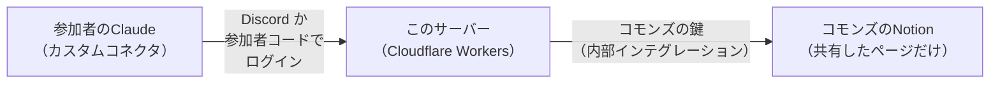

# コモンズの Notion につなぐ MCP サーバー

参加者の Claude から、コモンズの共有 Notion（知識コモンズ）を読み書きするための中継です。Cloudflare Workers の無料枠で動かします。

## なぜこの形か

- Notion の公式コネクタは、ワークスペースの**メンバー**しかつなげない。コモンズでは世話役1人だけがメンバーで、ほかの人はゲスト（無料で入れる）なので、公式コネクタでは読み書きできない
- そこで、コモンズに鍵（内部インテグレーション）を1つ作り、このサーバーがその鍵で読み書きする。参加者は自分の Claude にこのサーバーを足すだけ
- 鍵が届くのは、その鍵に共有したページ（と子ページ）だけ

## 参加者がつなぐ手順

1. コモンズの Discord サーバーに、招待リンクから入っておく
2. Claude で「カスタマイズ（Customize）」→「コネクタ（Connectors）」→「＋」→「カスタムコネクタを追加（Add custom connector）」
3. 名前は `Winegrowers Commons`、URL は入口のページに書いてある `https://…workers.dev/mcp`
4. 「接続（Connect）」を押し、出てきた画面で「Discord でログインしてつなぐ」→ Discord の画面で「認証（Authorize）」

Discord のサーバーに入っている人なら、これで通る。参加者コードは要らない。Discord を使わない人は、同じ画面の「参加者コード」から、世話役に受け取ったコードでつなぐ。

## できること

| ツール | すること |
| --- | --- |
| commons_search | ページとデータベースをタイトルで探す |
| commons_read | ページのプロパティと本文を読む。DBのIDなら列の定義を返す |
| commons_query_database | DBの行を条件で引く |
| commons_create_page | 子ページかDBの行を作る |
| commons_append | ページの末尾に書き足す |
| commons_update_properties | DBの行のプロパティを変える |
| commons_comment | ページにコメントする |
| discord_channels | コモンズの Discord のチャンネルと進行中のスレッドを一覧にする |
| discord_read | Discord のチャンネルの発言を読む。📌 の付いた発言だけにも絞れる |
| discord_inbox | 受け取り箱。自分か自分の AI（AI 用のロール）がメンションされた発言を集める（Discord でログインした人だけ） |
| discord_post | Discord に書き込む（ボット「コモンズのAI」の名前で、末尾に頼んだ人の名前が付く） |

Discord の道具は、Worker に `DISCORD_BOT_TOKEN`（secret）と `DISCORD_GUILD_ID`（変数）があるときだけ出る。読み書きできるのはそのサーバーのうち、`wrangler.jsonc` の `DISCORD_CHANNELS` に書いたチャンネル（いまは #一般・#提案・#議事録・#スキルの相談・#aiに聞く）と、その中のスレッドだけ。

`discord_post` は書き込みの道具なので、Claude は使う前に毎回「許可しますか」と聞く（Claude の設定で「常に許可」にしない限り）。

消す・アーカイブする道具は入れていない（戻せない操作は人が Notion の画面でする）。書き込みの末尾には、書いた人の名前が自動で付く（Notion 上の記録はすべて鍵の名前になるため）。

## 世話役が動かすとき（初回のみ）

手順

1. Cloudflare にログインし、`npx wrangler login`
2. `npx wrangler kv namespace create OAUTH_KV` で出た id を `wrangler.jsonc` の `kv_namespaces` に入れる（共有のサーバーは作成済み）
3. 公開URLは自動で決まる（独自ドメインに置くときだけ `PUBLIC_URL` を変数で渡す）
4. 鍵を Worker の secret に入れる（リポジトリには入れない）
   - `npx wrangler secret put NOTION_TOKEN`：Notion の「開発者ツール」→ コネクト「Commons MCP」の API トークン
   - `npx wrangler secret put DISCORD_BOT_TOKEN`：Discord 開発者画面のボット「コモンズのAI」の鍵（任意。入れると Discord の道具が出る。`/ai` で動いているボットと同じ鍵でよい）
   - Cloudflare の画面で Worker の「設定」→「変数とシークレット」に、変数 `DISCORD_GUILD_ID`（コモンズの Discord サーバーのID）を足す
   - Discord でログインを使うとき：Discord 開発者画面のアプリ「コモンズのAI」→「OAuth2」で、Redirects に `https://…workers.dev/discord/callback` を足し、Client Secret を `npx wrangler secret put DISCORD_CLIENT_SECRET` で入れる。変数 `DISCORD_CLIENT_ID`（アプリの ID）も画面で足す
   - 変数 `DISCORD_MEMBER_ROLE`（`wrangler.jsonc`）：「コモンズメンバー」ロールの名前。そのロールがサーバーにあれば、Discord でログインしてつなげるのはメンバーだけになる（入っただけの見学者は Discord の `/ai` まで。ground の docs/membership.md）。入れないあいだは、サーバーに入っている人は誰でもつなげる
   - `npx wrangler secret put MEMBER_CODES`（Discord を使わない人がいるときだけ）：`{"参加者コード":"表示名", …}` の JSON。参加者を足すときはこれを入れ直す
5. `npm install && npx wrangler deploy`

## 無料枠の目安

Workers の無料プランは1日10万リクエスト、KV は1日10万回の読み取りと1,000回の書き込み（2026年11月時点、Cloudflare の公式の制限表による）。数人で使う分には十分。
